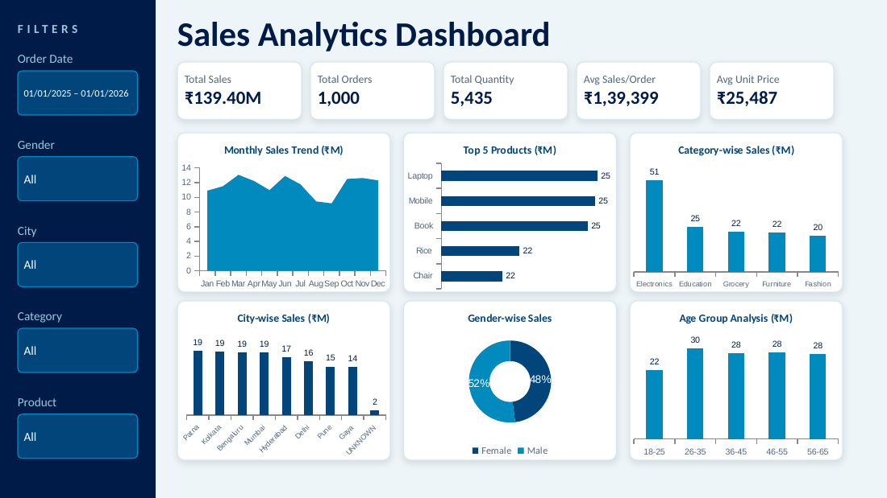

# Project 3: Power BI Sales Dashboard

One interactive page: 6 KPI cards, 6 charts and 4 slicers on the sales data.

| | |
|---|---|
| **Source folder** | [`Task 3/Dashboard.pbix`](https://github.com/1m-shyam01/ApexPlanet-Data-Analytics-Internship/tree/main/Task%203) in the original repository |
| **Tools** | Power BI, Power Query (M), DAX |
| **Part of** | ApexPlanet Data Analytics Internship |

## Project objective
Turn the sales dataset into an interactive dashboard that business users can filter and explore.

## Problem statement
Sales figures sit in a flat file; stakeholders need to see totals and trends by month, city, age group, product and gender, and filter them without writing queries.

## Dataset description
The Task 1 dataset loaded into Power BI as the `Dataset` table.

## Tools and technologies
- Power BI
- Power Query (M)
- DAX

## Methodology
1. Power Query: set column types, replaced blank Age with 0, trimmed City and replaced blank City with "Unknown".
2. Power Query: added an Age Group column (18-25 to 66+) with a conditional custom column.
3. DAX: one measure, `Average Unit Price = AVERAGE('Dataset'[Unit_Price])`.
4. DAX calculated columns: Month Name (SWITCH over MONTH), MonthNumber, Day Name and Day Number (FORMAT).
5. Built a 2150 x 1080 report page with cards, charts, slicers and a logo.

## Key analysis performed
- KPI cards: Total Sales, Count of Customer_ID, Average Sales, Total Orders, Total Quantity Sold, Average Unit Price.
- Charts: Sales By Month (area), Order By Month (area), Sales By City (bar), Sales By Age Group (bar), Product Based Sales (bar), Sales By Gender Basis (donut).
- Slicers: Month Name, Gender, City, Category.

## Important findings
- The report page has four slicers (Month Name, Gender, City, Category) for filtering the cards and charts.
- The cards sum the same Task 1 dataset as the SQL project, so unfiltered totals are ₹139.40M in sales and 5,435 units.
- Project 4 includes a separate dashboard slide that summarizes the same metrics.

## Project screenshots

*Dashboard slide from the Task 4 presentation (a slide-built dashboard, not an export of the .pbix page).*

## Not available in the repository
No exported screenshot of the .pbix report page is in the repository, so the image shown is the dashboard slide from the Task 4 deck.

## Repository link
[github.com/1m-shyam01/ApexPlanet-Data-Analytics-Internship](https://github.com/1m-shyam01/ApexPlanet-Data-Analytics-Internship/tree/main/Task%203)

[Back to the portfolio home](../../README.md)
