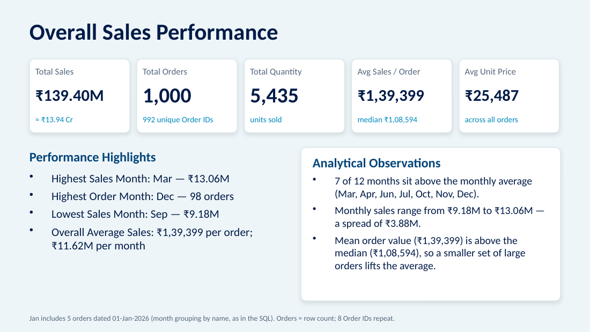
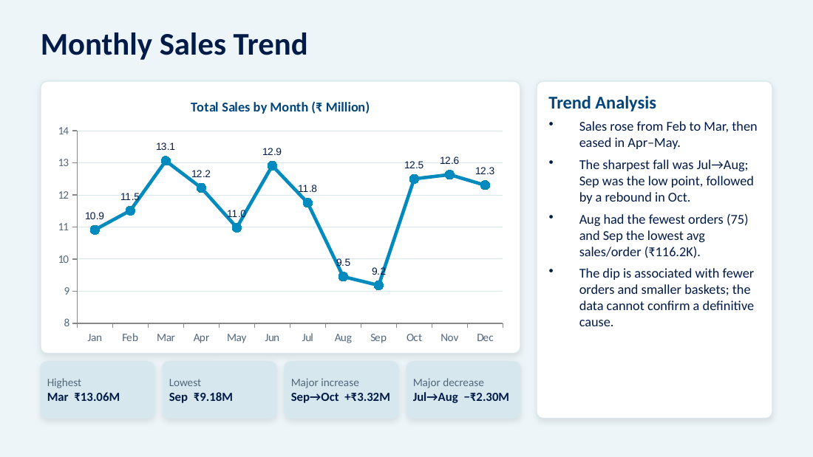
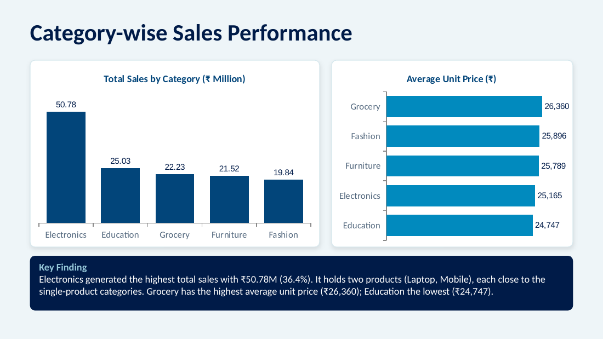
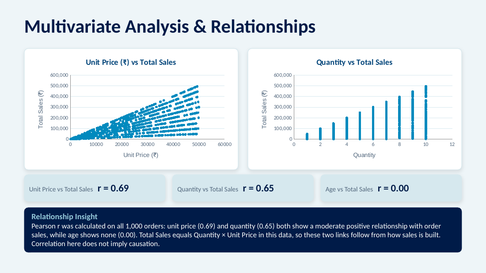

# Project 4: Sales Data Analysis Presentation

A 13-slide deck that explains the findings from the SQL and Power BI work.

| | |
|---|---|
| **Source folder** | [`Task 4/Sales Data Analysis.pptx`](https://github.com/1m-shyam01/ApexPlanet-Data-Analytics-Internship/tree/main/Task%204) in the original repository |
| **Tools** | PowerPoint, SQL, Power BI |
| **Part of** | ApexPlanet Data Analytics Internship |

## Project objective
Communicate the sales analysis as a clear story: performance, trends, products, cities, customers and relationships.

## Problem statement
Results in SQL and Power BI are hard for a business audience to read; they need a short, structured explanation with the key numbers and caveats.

## Dataset description
The Task 1 dataset (1,000 orders, ₹139.40M).

## Tools and technologies
- PowerPoint
- SQL
- Power BI

## Methodology
1. Structured the deck into nine topics: summary statistics, monthly sales, product and category, city, customer and demographic, SQL questions, multivariate analysis, insights, dashboard.
2. Used native charts: line, clustered column, clustered bar, scatter, doughnut and area.
3. Added caveats on slides where the data needs one (repeated Order_IDs, January grouping, missing ages).
4. Closed with a conclusion slide tied to each finding.

## Key analysis performed
- Descriptive statistics: mean vs median order value, monthly range.
- Monthly trend, month-over-month rises and falls, and order volume vs sales.
- Product, category and city contribution shares.
- Pearson correlation of unit price and quantity with total sales.

## Important findings
- Sales peak in March (₹13.06M) and are lowest in September (₹9.18M); the biggest rebound is September to October (+₹3.32M).
- Electronics leads with ₹50.78M (36.4%); Laptop is the top product at ₹25.44M (18.3%). The top 5 products give 85.8% of sales.
- Patna leads in sales (₹19.29M) and orders (135).
- Average order value (₹1,39,399) is above the median (₹1,08,594), so a smaller set of large orders lifts the average.
- Unit price (r = 0.69) and quantity (r = 0.65) relate moderately to order sales; the deck notes this follows from Total Sales = Quantity x Unit Price and does not imply causation.

## Project screenshots

*Slide 3: overall sales performance*

*Slide 4: monthly sales trend*

*Slide 7: category-wise sales*

*Slide 9: multivariate analysis*

## Not available in the repository
The deck is stored as a .pptx; no PDF export is in the repository.

## Repository link
[github.com/1m-shyam01/ApexPlanet-Data-Analytics-Internship](https://github.com/1m-shyam01/ApexPlanet-Data-Analytics-Internship/tree/main/Task%204)

[Back to the portfolio home](../../README.md)
