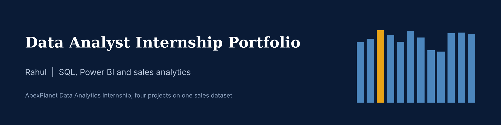

# Data Analyst Internship Portfolio

Hi, I am Rahul, an aspiring data analyst. This is the single place for my ApexPlanet Data Analytics Internship work: four projects on one retail sales dataset (1,000 orders, ₹139.40M in sales).

**Live site:** https://1m-shyam01.github.io/Rahul-DataAnalyst-Internship-Portfolio/

## Internship overview
Four tasks, each building on the last: prepare the data, analyse it in SQL, build a Power BI dashboard, present the findings.

| Task | Project | Tools | Links |
|---|---|---|---|
| 1 | Sales Dataset Preparation | CSV | [Write-up](Projects/Project-01/README.md) / [Code](https://github.com/1m-shyam01/ApexPlanet-Data-Analytics-Internship/tree/main/Task%201) |
| 2 | SQL Sales Analysis (23 questions) | SQL | [Write-up](Projects/Project-02/README.md) / [Code](https://github.com/1m-shyam01/ApexPlanet-Data-Analytics-Internship/tree/main/Task%202) |
| 3 | Power BI Sales Dashboard | Power BI, Power Query, DAX | [Write-up](Projects/Project-03/README.md) / [Code](https://github.com/1m-shyam01/ApexPlanet-Data-Analytics-Internship/tree/main/Task%203) |
| 4 | Sales Data Analysis Presentation (13 slides) | PowerPoint | [Write-up](Projects/Project-04/README.md) / [Code](https://github.com/1m-shyam01/ApexPlanet-Data-Analytics-Internship/tree/main/Task%204) |

## Final presentation
[Internship-Final-Presentation.pdf](Presentation/Internship-Final-Presentation.pdf)

## Key learnings and skills
[Documentation/Key-Learnings-and-Skills.md](Documentation/Key-Learnings-and-Skills.md)

## Highlights
- Sales peak in March (₹13.06M); Electronics gives 36.4% of sales; Patna is the top city.
- 23 SQL questions answered, including HAVING with subqueries.
- Power BI dashboard with 6 KPI cards, 6 charts and 4 slicers.

## Contact
- GitHub: [github.com/1m-shyam01](https://github.com/1m-shyam01)
- LinkedIn: YOUR_LINKEDIN_URL
- Email: YOUR_EMAIL

Code and data stay in the original repository: [ApexPlanet-Data-Analytics-Internship](https://github.com/1m-shyam01/ApexPlanet-Data-Analytics-Internship)
